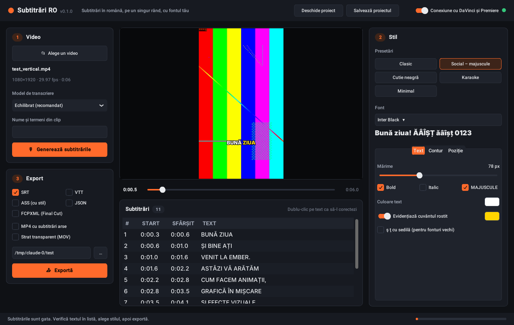

# Subtitrări RO

Aplicație desktop care pune subtitrări în limba română pe clipurile voastre (animații, motion graphics, reels). Încarci videoul, aplicația transcrie vocea și face subtitrări **pe un singur rând**. Apoi alegi fontul, culorile, conturul și poziția, iar rezultatul îl vezi direct pe un cadru din video.



## Ce face

- **Transcriere automată în română** cu Whisper, pe calculatorul tău. Videoul nu pleacă pe internet.
- **Subtitrări pe un rând.** Lățimea rândului se măsoară cu fontul ales, deci textul nu iese din cadru. Cuvintele de legătură („și”, „de”, „la”) nu rămân singure la capăt de rând.
- **Stil complet:** orice font instalat sau un fișier .ttf/.otf, cu mărime, bold, italic și MAJUSCULE. Mai alegi conturul, umbra, cutia din spate, poziția și animația (pop, fade). Cuvântul rostit poate fi evidențiat, ca la karaoke.
- **Diacritice corecte:** ș și ț cu virgulă. Dacă fontul ales nu are aceste litere, aplicația te anunță.
- **Exporturi pentru fiecare editor:** SRT, VTT, ASS, FCPXML (Final Cut), MP4 cu subtitrările arse și un strat transparent MOV (ProRes 4444) pe care îl pui peste video în orice editor.
- **Pluginuri** pentru DaVinci Resolve și Premiere Pro: subtitrările apar direct în timeline.

## Cum începi (Windows)

1. Instalează Python 3.10 sau mai nou de la <https://www.python.org/downloads/>. La instalare, bifează „Add Python to PATH”.
2. Descarcă ffmpeg de la <https://www.gyan.dev/ffmpeg/builds/> (varianta „release essentials”). Dezarhivează-l și pune folderul în `subtitrari-ro\ffmpeg`, astfel încât să existe `subtitrari-ro\ffmpeg\bin\ffmpeg.exe`.
3. Dă dublu-clic pe `PORNESTE.bat`. Prima dată instalează componentele, apoi deschide aplicația.

La prima transcriere, aplicația descarcă modelul Whisper (aproximativ 1,6 GB pentru „Echilibrat”). Descărcarea se face o singură dată.

**Aplicație .exe:** dă dublu-clic pe `COMPILEAZA_EXE.bat`. Rezultatul este în `dist\SubtitrariRO\`. Copiază tot folderul, nu doar fișierul .exe.

**macOS / Linux:** instalează ffmpeg (`brew install ffmpeg` sau `sudo apt install ffmpeg`), apoi rulează:

```
pip install -r requirements.txt
python -m subtitrari_ro
```

## Cum o folosești

1. **Video:** apasă „Alege un video”. La „Nume și termeni din clip” scrie numele proprii și brandurile care apar în voce (de exemplu `Ember, Cluj-Napoca, After Effects`). Apasă „Generează subtitrările”.
2. **Stil:** alege o presetare, apoi fontul și detaliile din filele Text, Contur și Poziție. Previzualizarea se actualizează singură. Mută cursorul de timp sau dă clic pe un rând din listă ca să vezi alt moment.
3. **Corectează:** dă dublu-clic pe textul unei subtitrări din listă, scrie corectura și apasă Enter.
4. **Export:** bifează formatele și apasă „Exportă”. Fișierele se salvează lângă video, dacă nu alegi alt folder.

„Salvează proiectul” păstrează textul corectat și stilul într-un fișier `.subtitrari.json`. Îl poți redeschide oricând, fără să transcrii din nou.

### Modele de transcriere

| Model | Când îl alegi |
|---|---|
| Rapid | Calculator fără placă video NVIDIA. Acuratețea e mai mică. |
| Echilibrat (recomandat) | Bun pentru română, rapid pe placă video |
| Precis | Cea mai bună acuratețe, cel mai lent |

Dacă ai placă video NVIDIA, aplicația o folosește automat. Dacă nu o poate folosi, continuă pe procesor.

## Cu ce editor merge

| Editor | Cel mai simplu | Cu fontul și stilul tău |
|---|---|---|
| **DaVinci Resolve** | pluginul pune SRT-ul pe un track de subtitrări | pluginul pune și stratul transparent pe un track video |
| **Premiere Pro** | pluginul creează un track de subtitrări | pluginul pune și stratul transparent pe un track video |
| **Final Cut Pro** | File → Import → Captions → fișierul .srt | importă fișierul .fcpxml: proiect nou cu videoul și titluri cu fontul tău |
| **CapCut** | importă fișierul .srt din meniul de subtitrări al CapCut (numele meniului diferă de la o versiune la alta) | exportă „MP4 cu subtitrări arse” |

Stratul transparent (MOV, ProRes 4444 cu canal alfa) merge în orice editor care citește transparența. Pune-l pe un track video deasupra clipului, la începutul timeline-ului.

Instalarea pluginurilor e descrisă în [pluginuri/README.md](pluginuri/README.md).

## Linie de comandă

```
python -m subtitrari_ro clip.mp4 --formate srt,fcpxml --arde
python -m subtitrari_ro clip.mp4 --stil "Social – majuscule" --font "Montserrat" --overlay
python -m subtitrari_ro fonturi        # lista fonturilor găsite
python -m subtitrari_ro server         # doar serverul pentru pluginuri, fără fereastră
```

## Probleme frecvente

- **„Nu am găsit programul ffmpeg”:** pune ffmpeg în `subtitrari-ro\ffmpeg\bin\` (vezi pasul 2 de la „Cum începi”).
- **Textul are litere greșite la nume proprii:** scrie numele la „Nume și termeni din clip” și generează din nou.
- **În locul literelor ș/ț apare alt font:** fontul ales nu are ș și ț cu virgulă. Alege alt font sau bifează „ş ţ cu sedilă” în fila Text.
- **Pluginul spune că aplicația nu răspunde:** deschide aplicația și verifică comutatorul „Conexiune cu DaVinci și Premiere” din dreapta sus.

## Pentru dezvoltatori

```
pip install -r requirements-dev.txt
python -m pytest
```

Structura codului:

| Fișier | Rol |
|---|---|
| `subtitrari_ro/transcriere.py` | Whisper (faster-whisper), cu timp pe fiecare cuvânt |
| `subtitrari_ro/segmentare.py` | împărțirea în subtitrări pe un rând |
| `subtitrari_ro/fonturi.py` | citește fonturile instalate, măsoară textul, verifică literele ș/ț |
| `subtitrari_ro/exporturi.py` | SRT, VTT, ASS, FCPXML, JSON |
| `subtitrari_ro/randare.py` | previzualizare, MP4 cu subtitrări arse, strat transparent (ffmpeg + libass) |
| `subtitrari_ro/server.py` | server local pentru pluginuri (doar 127.0.0.1, cu token) |
| `subtitrari_ro/gui.py`, `tema.py` | interfața (CustomTkinter) |
| `pluginuri/` | DaVinci Resolve (Python) și Premiere Pro (panou CEP) |
